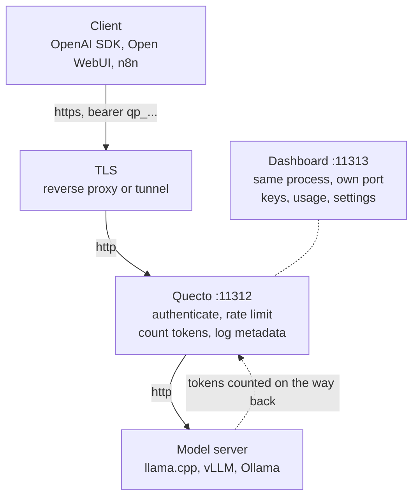

<p align="center">
  
</p>

---

A tiny proxy for safely exposing a self-hosted OpenAI-compatible LLM server to the internet. API keys with expiration, per-key limits on **requests and tokens**, lifetime token quotas, and metadata-only usage logs, behind a small dashboard.

One 11MB static binary, one SQLite file, nothing else.



## Run it

```bash
git clone https://github.com/jesdga95/quecto-proxy && cd quecto-proxy

# Creates the admin account on first start, then ignored. Save it, you cannot read it back.
echo "QUECTO_ADMIN_PASSWORD=$(openssl rand -base64 24)" > .env && cat .env

docker compose up -d --build
docker compose logs quecto   # expect: msg=listening addr=:11312
```

Edit `QUECTO_UPSTREAM_URL` in [docker-compose.yml](docker-compose.yml) if your model server is not on port 8080. On a stock Linux engine every `docker` command needs `sudo`; compose reads `.env` from the project directory, so the password survives it.

Open `http://localhost:11313/admin`, sign in, create a key, then point any OpenAI client at `http://your-host:11312/v1`:

```bash
curl -sS http://localhost:11312/v1/chat/completions \
  -H "Authorization: Bearer qp_your_key_here" \
  -H "Content-Type: application/json" \
  -d '{"model":"local","messages":[{"role":"user","content":"hello"}]}'
```

Without compose, `docker build -t quecto .` and pass the same variables with `-e`, publishing both ports. Write the password as `-e VAR="$VAR"`; the bare form reads it from Docker's own environment, which `sudo` clears. On Linux, `--add-host host.docker.internal:host-gateway` is what lets the container reach a model server on the host.

## Two ports, and what to expose

- **`:11312`, the API.** The only port that needs to be reachable. It answers 404 for every `/admin` URL, so whatever you point at it carries the API and nothing else.
- **`:11313`, the dashboard.** Nothing rate limits password guesses at the login, so keep it on your own network or put an identity layer in front of it.

## Where Quecto fits

Quecto is built for one specific case: one self-hosted model server, exposed publicly, with per-key limits and usage accounting. Gateways built for fleets of cloud providers do far more, and require Postgres, Redis, and a few gigabytes per worker to do it. A reverse proxy in front gives you TLS and a shared password, and tells you nothing about who spent what. Quecto is the small thing in between: keys that expire, a cap on what each one spends, and a record of it that never stores prompts.

## Configuration

| Variable | Default | |
|---|---|---|
| `QUECTO_UPSTREAM_URL` | required | Your model server, with or without the `/v1` suffix |
| `QUECTO_ADMIN_PASSWORD` | | Creates the admin account on first start, then ignored |
| `QUECTO_LISTEN` | `:11312` | `qp` in ASCII decimal, clear of llama.cpp on 8080 |
| `QUECTO_ADMIN_LISTEN` | `:11313` | The dashboard and its API. Set it to `QUECTO_LISTEN` to share one |
| `QUECTO_DB_PATH` | `./quecto.db` | |
| `QUECTO_UPSTREAM_API_KEY` | | Swapped in for the caller's key on the way out |
| `QUECTO_LOG_RETENTION_DAYS` | `30` | Hourly totals outlive raw rows, so charts stay long range |

Everything but the listen address and database path is also editable from the dashboard. The rest live in [`internal/config`](internal/config/config.go).

## Some technical details

- **Token limits reserve on admission and settle on completion,** since the cost is only knowable once a reply finishes. The per-minute bucket can go negative; clamping at zero would make oversized requests free.
- **A spent lifetime quota is terminal,** `401 exhausted_api_key` rather than a `429` that would trap an SDK in a backoff loop. A quota merely *held* by calls in flight answers `429 quota_pending` instead.
- **Streamed replies are still counted.** Quecto adds `stream_options` upstream and strips the usage frame back out, so callers see the same bytes as talking to the model directly. Responses carry OpenAI's own `X-RateLimit-*` headers.
- **Logs are metadata only.** Prompts and responses are never stored, and there is no setting to turn that on.

## When it does not come up

The container prints its reason and exits, so a start that vanishes from `docker ps` is visible in `docker logs quecto`.

| What you see | What it means |
|---|---|
| `no admin password is set` | `QUECTO_ADMIN_PASSWORD` never reached the container, see the `-e` note above |
| `QUECTO_UPSTREAM_URL is required` | Missing or empty, it has no default |
| 401 on a request | Key is wrong, expired, or revoked. The body says which |
| Connection error on a request | Quecto cannot reach the upstream. Check `QUECTO_UPSTREAM_URL` |
| 404 on `:11312/admin` | The dashboard is on its own port. Publish it with `-p 11313:11313` |

The password is only consumed when no admin account exists yet, so changing the variable later does nothing. Reset it from the dashboard instead.

## Development

```bash
make build   # dashboard first, then the binary that embeds it
make test
make bench   # roughly +50us per request, measured against a null upstream
```

The dashboard is never committed; `docker build` always compiles it from source. More in [CONTRIBUTING.md](CONTRIBUTING.md).

Quecto terminates no TLS and is meant to sit behind something that does. Threat model and known limitations: [SECURITY.md](SECURITY.md).
