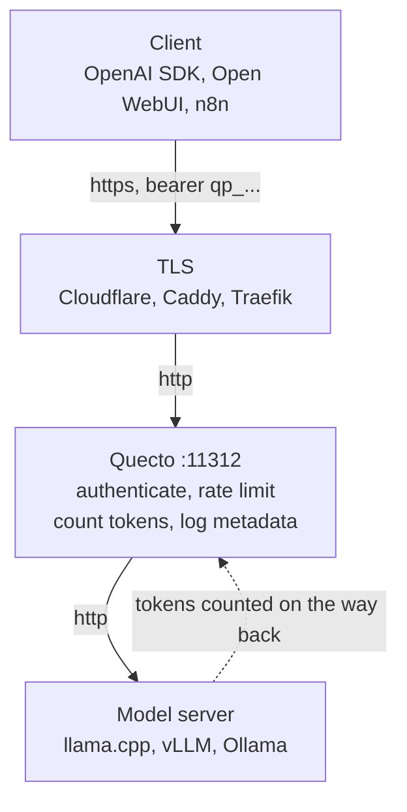

# Quecto

A tiny proxy for safely exposing a self-hosted OpenAI-compatible LLM server to the internet. API keys with expiration, per-key limits on **requests and tokens**, and metadata-only usage logs, behind a small dashboard.

One 11MB static binary, one SQLite file, nothing else.



## Run it

Every `docker` command below needs `sudo` on a stock Linux engine, where the socket is root owned. Docker Desktop and rootless installs do not. If you see `permission denied ... /var/run/docker.sock`, add the `sudo`.

```bash
git clone https://github.com/jesdga95/quecto-proxy && cd quecto-proxy

# The admin password creates the account on first start and is then ignored.
echo "QUECTO_ADMIN_PASSWORD=$(openssl rand -base64 24)" > .env
cat .env   # save this, you cannot read it back later

docker compose up -d --build
docker compose logs quecto   # expect: msg=listening addr=:11312
```

Compose reads `.env` from the project directory rather than from your shell, so the password arrives intact even under `sudo`, which clears the environment. Edit `QUECTO_UPSTREAM_URL` in [docker-compose.yml](docker-compose.yml) if your model server is not on port 8080.

Then open `http://localhost:11312/admin`, sign in, and create a key:

```bash
curl -sS http://localhost:11312/v1/chat/completions \
  -H "Authorization: Bearer qp_your_key_here" \
  -H "Content-Type: application/json" \
  -d '{"model":"local","messages":[{"role":"user","content":"hello"}]}'
```

Point any OpenAI client at `http://your-host:11312/v1`. Quecto speaks plain HTTP by design, so put TLS in front of it.

### Without compose

```bash
docker build -t quecto .

export QUECTO_ADMIN_PASSWORD=$(openssl rand -base64 24)
echo "save this, it is only used once: $QUECTO_ADMIN_PASSWORD"

docker run -d --name quecto --restart unless-stopped \
  -p 11312:11312 -v quecto-data:/data \
  -e QUECTO_UPSTREAM_URL=http://host.docker.internal:8080/v1 \
  -e QUECTO_ADMIN_PASSWORD="$QUECTO_ADMIN_PASSWORD" \
  --add-host host.docker.internal:host-gateway \
  quecto
```

`--restart unless-stopped` is what makes it survive a reboot. On Linux the engine has to come up too: `sudo systemctl enable --now docker`.

Write the password as `-e VAR="$VAR"` and not as a bare `-e VAR`. The bare form copies the value from Docker's own environment, which `sudo` clears, so under `sudo docker run` it passes nothing and the container exits 1 with `no admin password is set`.

`--add-host` is what makes `host.docker.internal` resolve on Linux, where it is not built in. It is how the container reaches a model server running on the host.

### When it does not come up

The container prints its reason and exits, so a start that vanishes from `docker ps` is always visible in the logs:

```bash
docker logs quecto
```

| What you see | What it means |
|---|---|
| `no admin password is set` | `QUECTO_ADMIN_PASSWORD` never reached the container, see the `-e` note above |
| `QUECTO_UPSTREAM_URL is required` | Missing or empty, it has no default |
| `permission denied ... /var/run/docker.sock` | Docker itself, not Quecto. Use `sudo`, or add yourself to the `docker` group |
| 401 on a request | Key is wrong, expired, or revoked. The body says which |
| Connection error on a request | Quecto cannot reach the upstream. Check `QUECTO_UPSTREAM_URL` and that the model server is listening |

The password is only consumed when no admin account exists yet. Once one is stored in the volume, changing the variable does nothing, so reset it from the dashboard instead.

## Configuration

| Variable | Default | |
|---|---|---|
| `QUECTO_UPSTREAM_URL` | required | Your model server, with or without the `/v1` suffix |
| `QUECTO_ADMIN_PASSWORD` | | Creates the admin account on first start, then ignored |
| `QUECTO_LISTEN` | `:11312` | `qp` in ASCII decimal, clear of llama.cpp on 8080 |
| `QUECTO_DB_PATH` | `./quecto.db` | |
| `QUECTO_UPSTREAM_API_KEY` | | Swapped in for the caller's key on the way out |
| `QUECTO_LOG_RETENTION_DAYS` | `30` | Hourly totals outlive raw rows, so charts stay long range |

Everything but the listen address and database path is also editable from the dashboard. The rest live in [`internal/config`](internal/config/config.go).

## The part that will surprise you

A request's token cost is only knowable *after* it finishes, so token limits reserve on admission and settle on completion. **The bucket is allowed to go negative.** One reply larger than the whole per-minute allowance leaves that key in debt, locked out until it refills. Clamping at zero would make oversized requests free. The dashboard shows the debt and counts down to when it clears.

To count tokens on streamed replies, Quecto adds `stream_options` to the upstream request and strips the resulting usage frame back out, so callers see a byte stream identical to talking to the model directly. Servers that reject the field are detected on first refusal and fall back. Responses carry OpenAI's own `X-RateLimit-*` headers, so SDK backoff logic works unchanged.

Logs are metadata only. Prompts and responses are never stored, and there is no setting to turn that on.

## Development

```bash
make build   # dashboard first, then the binary that embeds it
make test
make bench   # roughly +50us per request, measured against a null upstream
```

The dashboard is never committed; `docker build` always compiles it from source. More in [CONTRIBUTING.md](CONTRIBUTING.md).

Quecto terminates no TLS and is meant to sit behind something that does. Threat model and known limitations: [SECURITY.md](SECURITY.md).
