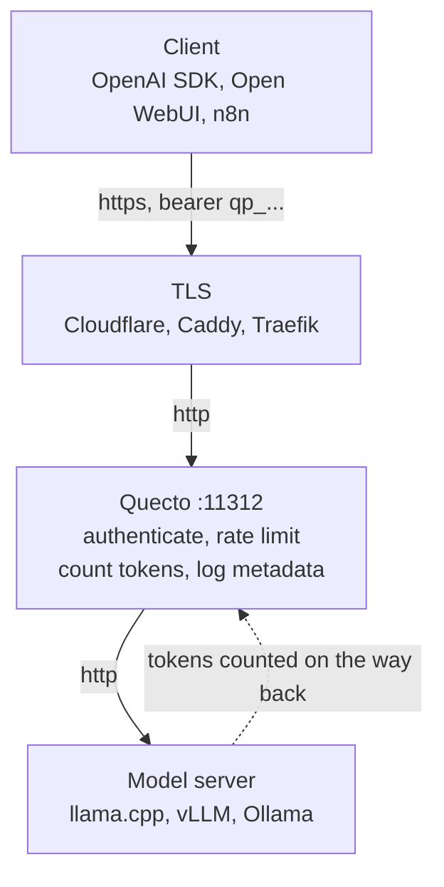

# Quecto

A tiny proxy for safely exposing a self-hosted OpenAI-compatible LLM server to the internet. API keys with expiration, per-key limits on **requests and tokens**, and metadata-only usage logs, behind a small dashboard.

One 11MB static binary, one SQLite file, nothing else.



## Run it

```bash
git clone https://github.com/jesdga95/quecto-proxy && cd quecto-proxy
docker build -t quecto .

export QUECTO_ADMIN_PASSWORD=$(openssl rand -base64 24)
echo "save this, it is only used once: $QUECTO_ADMIN_PASSWORD"

docker run -d -p 11312:11312 -v quecto-data:/data \
  -e QUECTO_UPSTREAM_URL=http://host.docker.internal:8080/v1 \
  -e QUECTO_ADMIN_PASSWORD \
  --add-host host.docker.internal:host-gateway \
  quecto
```

`--add-host` is what makes `host.docker.internal` resolve on Linux, where it is not built in. It is how the container reaches a model server running on the host.

Open `http://localhost:11312/admin`, create a key, then point any OpenAI client at `http://your-host:11312/v1`. Quecto speaks plain HTTP by design, so put TLS in front of it.

## Configuration

| Variable | Default | |
|---|---|---|
| `QUECTO_UPSTREAM_URL` | required | Your model server, with or without the `/v1` suffix |
| `QUECTO_ADMIN_PASSWORD` | | Creates the admin account on first start, then ignored |
| `QUECTO_LISTEN` | `:11312` | `qp` in ASCII decimal, clear of llama.cpp on 8080 |
| `QUECTO_DB_PATH` | `./quecto.db` | |
| `QUECTO_UPSTREAM_API_KEY` | | Swapped in for the caller's key on the way out |
| `QUECTO_LOG_RETENTION_DAYS` | `30` | Hourly totals outlive raw rows, so charts stay long range |

Everything but the listen address and database path is also editable from the dashboard. The rest live in [`internal/config`](internal/config/config.go).

## The part that will surprise you

A request's token cost is only knowable *after* it finishes, so token limits reserve on admission and settle on completion. **The bucket is allowed to go negative.** One reply larger than the whole per-minute allowance leaves that key in debt, locked out until it refills. Clamping at zero would make oversized requests free. The dashboard shows the debt and counts down to when it clears.

To count tokens on streamed replies, Quecto adds `stream_options` to the upstream request and strips the resulting usage frame back out, so callers see a byte stream identical to talking to the model directly. Servers that reject the field are detected on first refusal and fall back. Responses carry OpenAI's own `X-RateLimit-*` headers, so SDK backoff logic works unchanged.

Logs are metadata only. Prompts and responses are never stored, and there is no setting to turn that on.

## Development

```bash
make build   # dashboard first, then the binary that embeds it
make test
make bench   # roughly +50us per request, measured against a null upstream
```

The dashboard is never committed; `docker build` always compiles it from source. More in [CONTRIBUTING.md](CONTRIBUTING.md).

Quecto terminates no TLS and is meant to sit behind something that does. Threat model and known limitations: [SECURITY.md](SECURITY.md).
